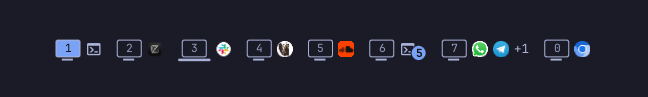
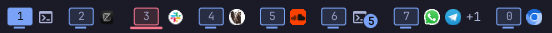

# wherespace

Know where every app is. An Omarchy bar widget that shows, without
switching, what is on each workspace and which screen it lives on.



- **Number order.** Workspaces stay in order: 1, 2, 3 … 0. Empty ones are hidden.
- **Drawn as their screen.** Each number sits inside a small drawing of the
  screen the workspace is on: a monitor, a laptop, an ultrawide, a portrait
  monitor or a TV. The focused workspace is filled; the others' numbers are
  greyed out.
- **A color per screen.** Each screen gets its own color from your theme, so
  you can tell your laptop from your monitor at a glance.
- **What's on it.** Up to two app icons per workspace, then `+N`. The focused
  workspace shows all of its apps. Icons follow the window layout: one from
  each side of the main split in turn (left, right, left, right …), so with a
  left/right split the two icons are the two halves.
- **Grouped windows.** Several windows of one app share an icon with a count
  bubble. Bare terminals show a console glyph; Chromium web apps show their
  own icon.
- **Click to jump.** Click a workspace to switch to it, or click an app icon
  to focus that app.
- **Hover for details.** Resting on a workspace shows a card with its screen
  and every window's icon, app name and title.
- **Fits the bar.** On a narrow bar it shows fewer icons rather than running
  into the clock.

## Follows your theme and font

wherespace has no colors or fonts of its own; everything comes from your
Omarchy setup and updates live:

- **Screen colors** are named colors from the active theme's `colors.toml`
  (`green`, `blue`, `magenta`, …), re-read on every theme switch.
- **Numbers, counts and glyphs** use the bar's text color, like the window
  title. With the transparent bar, that's the color Omarchy picks for your
  wallpaper.
- **The hover card and settings popup** use the theme's tooltip and popup
  colors.
- **Fonts** are the bar's and the shell's fonts; **sizes** follow Omarchy's
  text size (`omarchy display text size`) and the bar's icon size.

## Screenshots

The bar: each workspace is drawn as its screen (monitors in blue, the laptop
in red), with its apps next to it. The focused workspace is filled.



Right-click the workspaces to pick each screen's shape and color:


## Settings

Right-click the workspaces to choose each screen's **shape** and **color**
(from your theme's palette). Choices are saved per screen model, so they
survive changing ports, in this widget's entry in
`~/.config/omarchy/shell.json`:

```json
{
  "id": "io.github.apopovicius.wherespace",
  "screens": {
    "built-in": { "shape": "laptop", "color": "green" },
    "DELL P2725D": { "shape": "monitor", "color": "blue" }
  }
}
```

Colors can be theme color names (`green`, `blue`, `magenta`, `cyan`,
`yellow`, `orange`, `red`, `foreground`) or hex values.

## Install

```bash
omarchy plugin add https://github.com/apopovicius/omarchy-wherespace
omarchy plugin enable io.github.apopovicius.wherespace --section left --after omarchy.workspaces
omarchy plugin disable omarchy.workspaces
```

## Remove

```bash
omarchy plugin enable omarchy.workspaces --section left --before io.github.apopovicius.wherespace
omarchy plugin remove io.github.apopovicius.wherespace
```

## Requirements

Omarchy Quattro (Hyprland + the Omarchy shell). The widget runs `hyprctl`,
`jq`, `pgrep` and `ps`, which Omarchy ships by default. It only writes its
own settings (through `omarchy bar set`) and a small file of window open
times in your session's runtime directory (`$XDG_RUNTIME_DIR`), which is
cleared at logout.

## Notes

- Terminals that run one process for every window (Ghostty, `footclient`)
  may show the same program for all of their windows.
- Window positions are refreshed on window events and every few seconds, so
  a layout change may take a moment to reorder the icons.

## License

MIT

## Support

If wherespace is useful to you, you can [buy me a coffee on Ko-fi](https://ko-fi.com/andreipopovici) ☕
