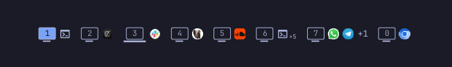
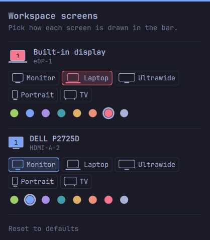
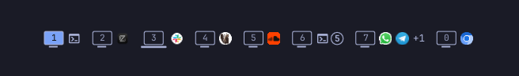
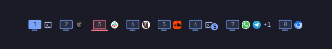
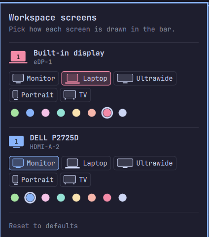

# wherespace through its releases

Screenshots captured for each release, newest first.

## v1.0.11

## v1.0.10

## v1.0.9

## v1.0.8

## v1.0.7

## v1.0.6

## v1.0.5

## v1.0.4

## v1.0.3

## v1.0.2

## v1.0.1

## v1.0.0

